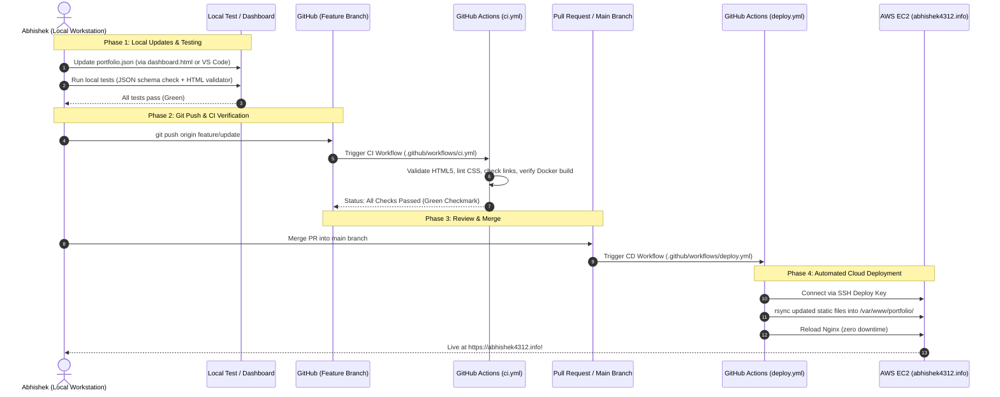

# MASTER PROJECT BLUEPRINT: Portfolio Modernization, 3-Theme System & GitOps CI/CD

**Target Identity:** Abhishek Pathak  
**Repository:** `raj4312/portfolio`  
**Production URL:** `https://abhishek4312.info`  
**Companion Documents:** `PDR_portfolio_system.md`, `TDR_portfolio_system.md`, `UI_UX_design_plan_3themes.md`  

---

## 1. End-to-End Developer Workflow (The "Push-to-Deploy" Cycle)

This blueprint implements Abhishek's explicit operational model:
> *"I want to work in a way like: say I update the code in my local file and system, test and plan, then push it to GitHub. As I push, it goes through CI/CD and then merges to main on GitHub. Once merged, then this update can be seen in my VPS domain webpage as well."*

---

## 2. Milestone Execution Roadmap

### Milestone 0: Workspace Cleanup & Secure Restructuring
- **Action 0.1:** Move active portfolio files into the root of `Final/` (`index.html`, `assets/css/`, `assets/js/`, `assets/img/`, `assets/data/`).
- **Action 0.2:** Eradicate all OS artifacts (`.DS_Store`) and purge sensitive test files (`src/backend/server.js` with plaintext credentials).
- **Action 0.3:** Setup Git hygiene:
  - Create robust `.gitignore` (ignoring `node_modules/`, `*.log`, `.env`, temporary assets).
  - Create developer `README.md` with badging, architecture diagrams, and run commands.
  - Create MIT `LICENSE`.

---

### Milestone 1: Data Decoupling & Content Model (`portfolio.json`)
- **Action 1.1:** Author `assets/data/portfolio.json` with Abhishek's complete verified profile:
  - **Hero & Identity:** Abhishek Pathak, Dual-Degree (IIT Madras & CSVTU Bhilai), Full-Stack Backend & AI focus.
  - **Showcase 1 (TMA):** Trekking Management Application with Tenant 0 (`tma.tenant0.abhishek4312.info`), Tenant 1 (`tma.tenant1.abhishek4312.info`), and pre-seeded demo login (`admin@demo.com | Demo@123`).
  - **Showcase 2 (LMS/EMP):** Examination Management Portal (`lms.abhishek4312.info`), role-based viva system, Chart.js engine, and pre-seeded demo login (`examiner@demo.com | Demo@123`).
  - **Showcase 3 (Cloud CI/CD):** AWS EC2 1 GB low-memory tuning, Docker, Let's Encrypt SSL, GitHub Actions.
  - **Technical Skills:** Categorized into Languages & Frameworks, Backend & Cloud, Tools & Databases.
  - **Education:** IIT Madras (BS in Data Science) & CSVTU Bhilai (B.Tech CSE - AI).
  - **Achievements:** NAEST Regional 2nd Prize, NCC Cadet, District Swimmer.
  - **Verified Contacts:** Phone (`+91 6394843151`), Email (`abhishekpathak4312@gmail.com`), GitHub (`github.com/raj4312`), LinkedIn (`linkedin.com/in/abhishek-pathak-342a03308`).
- **Action 1.2:** Copy verified CV document to `assets/docs/ABHISHEKPATHAK_CV.pdf` for direct one-click downloading.

---

### Milestone 2: Modern Frontend Implementation (Zero jQuery, 3-Theme CSS)
- **Action 2.1: Semantic HTML5 Structure (`index.html`):**
  - Fix all unclosed tags and remove raw DOM comment bleeds.
  - Add SEO metadata, OpenGraph preview tags, and favicon.
  - Structure sections: Header & Theme Switcher, Hero, Projects Showcase, Skills, Education & Achievements, Contact, Footer.
- **Action 2.2: 3-Theme CSS Engine (`assets/css/style.css`):**
  - Implement CSS variables for:
    - **Theme 1 (Cyber Dark):** `#080b11` + `#ffbd39` (Electric Gold)
    - **Theme 2 (GitHub Slate):** `#0d1117` + `#58a6ff` (Electric Blue)
    - **Theme 3 (Clean Light):** `#f8fafc` + `#2563eb` (Royal Blue)
  - Responsive Grid & Flexbox system (320px mobile to 4K displays).
  - High-contrast accessibility compliance (WCAG AA).
- **Action 2.3: Zero-Dependency Modular Vanilla JavaScript (`assets/js/main.js`):**
  - Dynamic content hydration from `portfolio.json`.
  - Native theme toggle with `localStorage` persistence.
  - One-click copy interaction for demo credentials (`Copied to clipboard!`).
  - Native smooth scrolling & mobile menu toggle.
  - 100% jQuery-free. Total JS bundle < 5 KB.

---

### Milestone 3: Local Developer Content Dashboard (`dashboard.html`)
- **Action 3.1:** Author `dashboard.html` and `assets/js/dashboard.js`:
  - Live form controls for Profile, Projects, Skills, and Academics.
  - Real-time schema validation with instant error flags for broken URLs.
  - One-click "Download Updated portfolio.json" button.
  - Live Theme Preview switcher to check updates across all 3 themes before committing.

---

### Milestone 4: Docker & Low-Memory AWS EC2 Nginx Configuration
- **Action 4.1:** Author Alpine-based `Dockerfile`:
  - Strips documentation/dashboard files from production image.
  - Total container memory usage < 15 MB RAM.
- **Action 4.2:** Author production `nginx.conf`:
  - Gzip compression enabled for all text, CSS, JS, and JSON assets.
  - Security headers (`X-Content-Type-Options`, `X-Frame-Options`, `Referrer-Policy`).
  - Cache-Control headers for static assets (30-day cache).

---

### Milestone 5: GitHub Actions CI/CD Pipeline
- **Action 5.1: Pull Request CI Pipeline (`.github/workflows/ci.yml`):**
  - Step 1: Validates `assets/data/portfolio.json` using Python/Node JSON validator.
  - Step 2: HTML5 validation check.
  - Step 3: Link checker (ensures no broken internal anchors or dead links).
  - Step 4: Docker build test.
- **Action 5.2: Production Deploy CD Pipeline (`.github/workflows/deploy.yml`):**
  - Triggers on push/merge to `main`.
  - Connects securely to AWS EC2 using GitHub Actions Secrets (`AWS_EC2_SSH_KEY`, `AWS_EC2_HOST`, `AWS_EC2_USER`).
  - Uses `rsync` to sync static files directly into `/var/www/portfolio/`.
  - Executes `sudo systemctl reload nginx` for instant, zero-downtime updates on `https://abhishek4312.info`.

---

### Milestone 6: Verification & Final Acceptance
- **Action 6.1:** Run local web server and verify:
  - Hero, dual-degree badges, and bio display correctly.
  - TMA and LMS cards display live links, GitHub links, and copyable demo credentials.
  - Theme switcher toggles smoothly between Cyber Dark, GitHub Slate, and Clean Light.
  - Dashboard loads, validates, and exports JSON cleanly.
- **Action 6.2:** Final git commit and readiness report.
