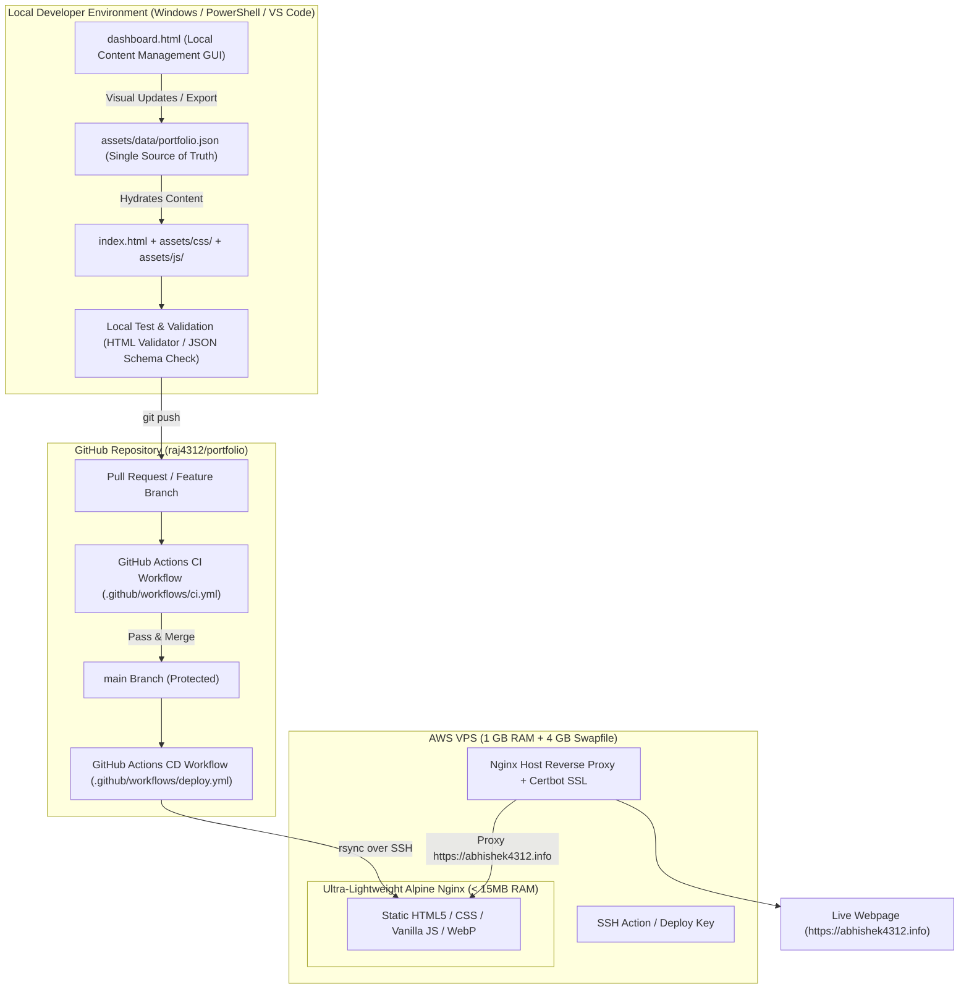

# TECHNICAL DESIGN REPORT (TDR): Personal Portfolio & Developer Management System

**Target Identity:** Abhishek Pathak  
**Domain:** `abhishek4312.info`  
**Host Environment:** AWS EC2 t2.micro / t3.micro (Ubuntu 24.04 LTS, 1 GB RAM, 4 GB Swap)  
**Companion Documents:** `PDR_portfolio_system.md`, `UI_UX_design_plan_3themes.md`, `MASTER_PROJECT_BLUEPRINT.md`  

---

## 1. System Architecture Overview



---

## 2. Decoupled Data Model (`portfolio.json`)

All dynamic portfolio data is stored in `assets/data/portfolio.json`. This decouples content updates from presentation logic.

### JSON Schema Structure
```json
{
  "$schema": "http://json-schema.org/draft-07/schema#",
  "title": "PortfolioData",
  "type": "object",
  "required": ["profile", "education", "skills", "projects", "achievements", "contact"],
  "properties": {
    "profile": {
      "type": "object",
      "properties": {
        "name": { "type": "string" },
        "titles": { "type": "array", "items": { "type": "string" } },
        "tagline": { "type": "string" },
        "bio": { "type": "array", "items": { "type": "string" } },
        "location": { "type": "string" },
        "email": { "type": "string", "format": "email" },
        "phone": { "type": "string" },
        "github": { "type": "string", "format": "uri" },
        "linkedin": { "type": "string", "format": "uri" },
        "avatarUrl": { "type": "string" },
        "resumeUrl": { "type": "string" }
      }
    },
    "education": {
      "type": "array",
      "items": {
        "type": "object",
        "properties": {
          "degree": { "type": "string" },
          "institution": { "type": "string" },
          "period": { "type": "string" },
          "grade": { "type": "string" },
          "status": { "type": "string" },
          "description": { "type": "string" },
          "highlights": { "type": "array", "items": { "type": "string" } }
        }
      }
    },
    "projects": {
      "type": "array",
      "items": {
        "type": "object",
        "properties": {
          "id": { "type": "string" },
          "title": { "type": "string" },
          "category": { "type": "string", "enum": ["Full-Stack", "Backend & Cloud", "AI & Data"] },
          "featured": { "type": "boolean" },
          "tagline": { "type": "string" },
          "description": { "type": "string" },
          "techStack": { "type": "array", "items": { "type": "string" } },
          "architectureHighlights": { "type": "array", "items": { "type": "string" } },
          "liveUrls": {
            "type": "array",
            "items": {
              "type": "object",
              "properties": {
                "label": { "type": "string" },
                "url": { "type": "string", "format": "uri" }
              }
            }
          },
          "githubUrl": { "type": "string", "format": "uri" },
          "demoCredentials": {
            "type": "object",
            "properties": {
              "username": { "type": "string" },
              "password": { "type": "string" },
              "role": { "type": "string" }
            }
          }
        }
      }
    },
    "skills": {
      "type": "object",
      "properties": {
        "languagesAndFrameworks": { "type": "array", "items": { "type": "string" } },
        "backendAndCloud": { "type": "array", "items": { "type": "string" } },
        "toolsAndDatabases": { "type": "array", "items": { "type": "string" } }
      }
    },
    "achievements": {
      "type": "array",
      "items": {
        "type": "object",
        "properties": {
          "title": { "type": "string" },
          "organization": { "type": "string" },
          "year": { "type": "string" },
          "badge": { "type": "string" },
          "description": { "type": "string" }
        }
      }
    }
  }
}
```

---

## 3. Local Developer Content Dashboard (`dashboard.html`)

To provide Abhishek with an intuitive, zero-overhead way to manage portfolio details without touching HTML or risking syntax errors:

1. **Architecture:** Single-page local HTML application (`dashboard.html` + `assets/js/dashboard.js`).
2. **Key Capabilities:**
   - **Load Data:** Fetches local `assets/data/portfolio.json` into structured, reactive form cards.
   - **Interactive Sections:**
     - Profile Info Editor (Name, Bio, Taglines, Social Links, Resume path).
     - Projects Manager (Add, edit, remove, reorder projects; configure multi-tenant endpoints and demo logins).
     - Skills Manager (Tag-input interface for Languages, Backend, DevOps, Tools).
     - Education & Honors Editor (IIT Madras, CSVTU Bhilai, NAEST, NCC).
     - Theme Previewer (Test live content across all 3 themes).
   - **Export & Apply:**
     - **Save/Export Button:** Generates a pristine, validated, formatted `portfolio.json` download.
     - **Schema Validator:** Checks JSON compliance in real time before allowing export to prevent broken production deployments.

---

## 4. Multi-Theme Token Architecture

Themes are powered by CSS Custom Properties (`--tokens`) attached to the `<html>` or `<body>` element via `data-theme`:

| Token Name | Theme 1: Cyber Dark (`data-theme="cyber"`) | Theme 2: GitHub Slate (`data-theme="slate"`) | Theme 3: Clean Light (`data-theme="light"`) |
| :--- | :--- | :--- | :--- |
| `--bg-base` | `#080b11` (Deep Obsidian) | `#0d1117` (GitHub Dark Canvas) | `#f8fafc` (Slate Paper Light) |
| `--bg-surface` | `#111622` (Glass Charcoal) | `#161b22` (Card Dark) | `#ffffff` (Pure White Card) |
| `--bg-surface-elevated`| `#182030` | `#21262d` | `#f1f5f9` |
| `--text-primary` | `#f1f5f9` (Crisp Ice) | `#c9d1d9` (Off-white) | `#0f172a` (Slate 900) |
| `--text-muted` | `#94a3b8` | `#8b949e` | `#64748b` |
| `--accent-primary` | `#ffbd39` (Electric Gold) | `#58a6ff` (Electric Blue) | `#2563eb` (Modern Royal Blue) |
| `--accent-hover` | `#e5a82e` | `#79c0ff` | `#1d4ed8` |
| `--border-color` | `rgba(255, 189, 57, 0.15)` | `#30363d` | `#e2e8f0` |
| `--badge-bg` | `rgba(255, 189, 57, 0.1)` | `rgba(88, 166, 255, 0.15)` | `rgba(37, 99, 235, 0.1)` |

**Client-Side Switcher Logic (`assets/js/theme.js`):**
```javascript
const THEME_KEY = 'ap_portfolio_theme';
const validThemes = ['cyber', 'slate', 'light'];

export function initTheme() {
  const savedTheme = localStorage.getItem(THEME_KEY) || 'cyber';
  setTheme(savedTheme);
}

export function setTheme(theme) {
  if (!validThemes.includes(theme)) theme = 'cyber';
  document.documentElement.setAttribute('data-theme', theme);
  localStorage.setItem(THEME_KEY, theme);
  const themeSelector = document.getElementById('theme-select');
  if (themeSelector) themeSelector.value = theme;
}
```

---

## 5. End-to-End GitOps CI/CD Lifecycle

The complete developer workflow specified by Abhishek:
$$\text{Local Edit} \longrightarrow \text{Local Test} \longrightarrow \text{Git Push} \longrightarrow \text{CI Check} \longrightarrow \text{Merge} \longrightarrow \text{CD to AWS VPS} \longrightarrow \text{Live at abhishek4312.info}$$

### Stage 1: Local Development & Validation
```bash
# 1. Update data via dashboard or code in VS Code
# 2. Run local schema & link validation
npm run test:schema
npm run test:lint

# 3. Commit with semantic commit message
git checkout -b feature/update-projects
git add .
git commit -m "feat(projects): update TMA and LMS deployment endpoints and demo keys"
git push origin feature/update-projects
```

### Stage 2: GitHub Actions CI Workflow (`.github/workflows/ci.yml`)
Triggers on all pull requests and pushes to non-main branches:
1. **Lint & Validation Job:**
   - Validates `assets/data/portfolio.json` against `schema.json`.
   - Validates HTML5 markup using `html-validate`.
   - Lints CSS formatting using `stylelint`.
   - Executes dead link checker across all internal anchor tags and asset paths.
2. **Container Build Verification:**
   - Executes `docker build -t portfolio:test .` to ensure image compiles cleanly without missing assets.

### Stage 3: GitHub Actions CD Workflow (`.github/workflows/deploy.yml`)
Triggers automatically when a PR is merged into `main`:
```yaml
name: Production CD - Deploy to AWS VPS

on:
  push:
    branches: [ main ]

jobs:
  deploy:
    runs-on: ubuntu-latest
    steps:
      - name: Checkout Code
        uses: actions/checkout@v4

      - name: Setup SSH Connection
        uses: webfactory/ssh-agent@v0.9.0
        with:
          ssh-private-key: ${{ secrets.AWS_EC2_SSH_KEY }}

      - name: Deploy to AWS EC2 VPS
        run: |
          # Sync static assets to VPS webroot
          rsync -avz --delete \
            -e "ssh -o StrictHostKeyChecking=no -p ${{ secrets.AWS_SSH_PORT || 22 }}" \
            ./ ${{ secrets.AWS_EC2_USER }}@${{ secrets.AWS_EC2_HOST }}:/var/www/portfolio/

          # Reload Nginx with zero downtime
          ssh -o StrictHostKeyChecking=no ${{ secrets.AWS_EC2_USER }}@${{ secrets.AWS_EC2_HOST }} \
            "sudo systemctl reload nginx || sudo docker exec nginx_proxy nginx -s reload"
```

---

## 6. AWS Low-Memory Nginx Production Configuration

To ensure the portfolio consumes virtually zero RAM on the 1 GB EC2 VPS:

### Alpine Nginx `Dockerfile`
```dockerfile
FROM nginx:alpine
LABEL maintainer="Abhishek Pathak <abhishekpathak4312@gmail.com>"

# Copy custom low-memory nginx configuration
COPY nginx.conf /etc/nginx/conf.d/default.conf

# Copy static assets
COPY . /usr/share/nginx/html/

# Remove dashboard and source markdown from production webroot
RUN rm -rf /usr/share/nginx/html/plan \
           /usr/share/nginx/html/dashboard.html \
           /usr/share/nginx/html/.github

EXPOSE 80
CMD ["nginx", "-g", "daemon off;"]
```

### Production `nginx.conf` (Gzip, Cache & Security Headers)
```nginx
server {
    listen 80;
    server_name abhishek4312.info www.abhishek4312.info;
    root /usr/share/nginx/html;
    index index.html;

    # Low-memory buffer limits
    client_body_buffer_size 16k;
    client_header_buffer_size 1k;

    # Gzip Compression
    gzip on;
    gzip_vary on;
    gzip_min_length 1024;
    gzip_types text/plain text/css application/json application/javascript image/svg+xml;

    # Security Headers
    add_header X-Content-Type-Options nosniff always;
    add_header X-Frame-Options SAMEORIGIN always;
    add_header X-XSS-Protection "1; mode=block" always;
    add_header Referrer-Policy "strict-origin-when-cross-origin" always;

    # Static Caching
    location ~* \.(css|js|webp|jpg|png|svg|pdf)$ {
        expires 30d;
        add_header Cache-Control "public, no-transform";
    }

    location / {
        try_files $uri $uri/ /index.html;
    }
}
```
