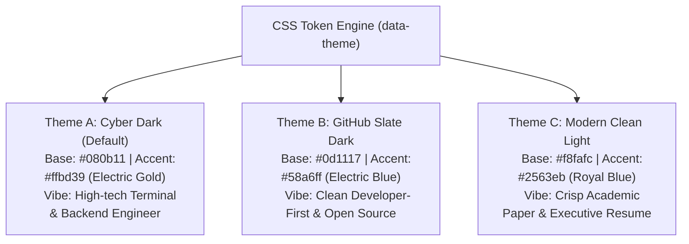

# UI/UX DESIGN PLAN: Multi-Theme Portfolio & Developer Dashboard

**Target Identity:** Abhishek Pathak  
**Audience:** Technical Recruiters, Engineering Managers, Peer Developers  
**Core Deliverables:** 3-Theme Public Portfolio (`index.html`) & Local Content Dashboard (`dashboard.html`)  
**Companion Documents:** `PDR_portfolio_system.md`, `TDR_portfolio_system.md`, `MASTER_PROJECT_BLUEPRINT.md`  

---

## 1. Design Philosophy & Visual Language

1. **Information-First Hierarchy:** The most important engineering signals — **Dual Degree (IIT Madras + CSVTU Bhilai)** and **Cloud-Deployed Showcase Projects (TMA, LMS)** — are positioned above the fold with zero scrolling ambiguity.
2. **Zero-Friction Recruiter Access:** No reviewer should be blocked by missing credentials. Every showcased application includes an interactive, one-click copyable demo credential badge (`examiner@demo.com | Demo@123`).
3. **Motion with Purpose:** Transitions are crisp, hardware-accelerated CSS animations (sub-300ms) with full respect for `prefers-reduced-motion`.
4. **WCAG 2.1 AA Compliance:** Minimum contrast ratio of $\ge 4.5:1$ across all three themes for normal text, explicit focus rings (`:focus-visible`), and descriptive ARIA labels.

---

## 2. The 3 Theme Specifications



### Theme A: Cyber Dark (Default)
- **Backgrounds:** Canvas `#080b11`, Surface Card `#111622`, Elevated Card `#182030`.
- **Accents:** Electric Gold/Amber `#ffbd39`, Hover `#e5a82e`, Glow `rgba(255, 189, 57, 0.25)`.
- **Text:** Primary `#f8fafc`, Secondary `#94a3b8`, Monospace Tags `#ffbd39`.
- **Borders:** Thin glowing borders `rgba(255, 189, 57, 0.18)`.
- **Character:** Sharp, modern, high-contrast, designed to make project cards pop.

### Theme B: GitHub Slate Dark
- **Backgrounds:** Canvas `#0d1117`, Surface Card `#161b22`, Elevated Card `#21262d`.
- **Accents:** Electric Blue `#58a6ff`, Secondary Green `#3fb950`, Cyan `#39c5cf`.
- **Text:** Primary `#c9d1d9`, Secondary `#8b949e`, Code `#79c0ff`.
- **Borders:** Subtle slate `#30363d`.
- **Character:** Standard GitHub/developer look, clean and understated.

### Theme C: Modern Clean Light
- **Backgrounds:** Canvas `#f8fafc`, Surface Card `#ffffff`, Elevated Card `#f1f5f9`.
- **Accents:** Deep Royal Blue `#2563eb`, Hover `#1d4ed8`.
- **Text:** Primary `#0f172a`, Secondary `#475569`, Muted `#94a3b8`.
- **Borders:** Slate `#e2e8f0` with soft ambient drop-shadows (`0 4px 20px -2px rgba(0, 0, 0, 0.05)`).
- **Character:** Highly legible, paper-like clarity, perfect for daylight review.

### Theme Switcher UI
A compact, accessible control embedded directly in the sticky navigation header:
- **Desktop:** Compact segmented pill with theme icons (⚡ Cyber, 🐙 Slate, ☀️ Light).
- **Mobile:** Single toggle icon that cycles through themes with haptic/visual feedback.
- **Persistence:** Stored in `localStorage` under key `ap_portfolio_theme`.

---

## 3. Public Portfolio Component Specifications (`index.html`)

### 1. Sticky Navigation Header
- **Layout:** Flexbox with frosted-glass background (`backdrop-filter: blur(12px)`).
- **Branding:** `Abhishek.dev` with small glowing status indicator (🟢 *Open to Opportunities*).
- **Nav Links:** `About`, `Projects`, `Skills`, `Education`, `Contact`.
- **Actions:** Theme Switcher Pill + "Download CV" button.

### 2. Hero Section
- **Badge:** `Dual Degree · IIT Madras & CSVTU Bhilai` in rounded pill with accent border.
- **Name & Headline:** 
  - `Abhishek Pathak`
  - Dynamic typewriter subtitle: `Software Engineer · Full-Stack & Backend Specialist · AI Enthusiast`.
- **Bio Summary:** 2 concise sentences emphasizing strong foundation in data structures, API architecture, Docker, and AWS cloud hosting.
- **CTAs:**
  - `[Explore Live Projects]` (smooth scrolls to `#projects`).
  - `[Download Verified CV (PDF)]` (direct download to `assets/docs/ABHISHEKPATHAK_CV.pdf`).
  - Circular social icon links (GitHub, LinkedIn, Email).

### 3. Featured Projects Showcase Cards (The Centerpiece)

#### Card 1: Trekking Management Application (TMA)
- **Header:** `Multi-Tenant SaaS Expedition Platform` + `Dockerized` badge.
- **Key Architecture Bullet:** Multi-tenant architecture running isolated database schemas for multiple trekking clubs with automated Pytest test suite.
- **Endpoints Display:**
  - `[Tenant 0: Himalayas Club]` &rarr; `https://tma.tenant0.abhishek4312.info`
  - `[Tenant 1: Western Ghats Club]` &rarr; `https://tma.tenant1.abhishek4312.info`
- **One-Click Demo Credentials Box:**
  ```
  🔑 Recruiter Demo Access
  User: admin@demo.com  [Copy]
  Pass: Demo@123        [Copy]
  ```
- **Actions:** `[Live Demo]` (dropdown with tenants) + `[GitHub Repo]`.

#### Card 2: Examination Management Portal (LMS / EMP)
- **Header:** `Academic Evaluation & Proctored Viva System` + `Role-Based RBAC` badge.
- **Key Architecture Bullet:** Full-featured evaluation system with Examiner/Student portals, automated viva scheduling, and Chart.js analytics engine.
- **Endpoint:** `https://lms.abhishek4312.info`.
- **One-Click Demo Credentials Box:**
  ```
  🔑 Recruiter Demo Access
  User: examiner@demo.com  [Copy]
  Pass: Demo@123          [Copy]
  ```
- **Actions:** `[Launch Live App]` + `[GitHub Repo]`.

#### Card 3: 3-Project CI/CD & AWS Student EC2 Infrastructure
- **Header:** `Production Cloud & DevOps Ecosystem` + `Low-Memory Optimized` badge.
- **Visual Diagram / Key Metrics:** 1 GB RAM EC2 instance, 4 GB Swapfile, Nginx Reverse Proxy, Let's Encrypt Wildcard SSL, automated GitHub Actions push-to-deploy pipeline.

### 4. Technical Skills Grid
Grouped into 3 interactive, responsive category cards:
1. **Languages & Frameworks:** Python, Flask, JavaScript (ES6+), SQL, HTML5/CSS3.
2. **Backend & DevOps:** Docker, Docker Compose, Nginx, GitHub Actions CI/CD, Gunicorn, PostgreSQL, RESTful APIs, Linux/Bash.
3. **Data & Developer Tools:** Data Cleaning, Data Analysis, Git, GitHub, VS Code, Postman.

### 5. Education & Achievements Timeline
Two-column card layout:
- **Left Column: Academics**
  - **Indian Institute of Technology, Madras (IIT Madras):** BS in Data Science & Applications (2024–2028).
  - **CSVTU Bhilai:** B.Tech in Computer Science & Engineering (Honours – AI Specialization, 2025–2029).
  - **St. Therese's School:** Class XII (87%), Class X (89%).
- **Right Column: Achievements & Co-Curricular**
  - **NAEST Regional 2nd Prize Winner** (National Anveshika Experimental Skill Test).
  - **NCC Cadet** (Discipline, leadership, team coordination).
  - **District-Level Swimmer** (Athletic consistency and dedication).

### 6. Contact Section & Verified Links
- Clear direct contact cards:
  - Email: `abhishekpathak4312@gmail.com` (with one-click copy).
  - Phone: `+91 6394843151`.
  - Location: Lucknow / Kushinagar, UP, India.
  - Profiles: GitHub (`github.com/raj4312`) & LinkedIn (`linkedin.com/in/abhishek-pathak-342a03308`).
- Clean static contact form with clientside validation.

---

## 4. Local Content Dashboard UI Specification (`dashboard.html`)

The dashboard is Abhishek's private local control center. It runs entirely in the browser using HTML5 LocalStorage, File API, and JSON Schema validation.

### Dashboard Layout & Wireframe
```
+-----------------------------------------------------------------------------------+
|  [⚡ Abhishek Portfolio Manager]                  [Theme: Cyber ▼]  [💾 Export JSON] |
+-----------------------------------------------------------------------------------+
|  SIDEBAR NAV       |  MAIN FORM PANEL                                            |
|  • Profile & Bio   |  [Profile Header]                                           |
|  • Projects (3)    |  Full Name: [Abhishek Pathak              ]                 |
|  • Skills          |  Primary Title: [Full-Stack & Backend Engineer]             |
|  • Education       |  Dual Degree: [IIT Madras & CSVTU Bhilai  ]                 |
|  • Achievements    |                                                             |
|  • Live Preview    |  [Project Manager: TMA / LMS / EC2]                         |
|                    |  + Add New Project                                          |
|                    |  Card 1: Trekking Management App                            |
|                    |    Live URL Tenant 0: [https://tma.tenant0.abhishek4312...] |
|                    |    Live URL Tenant 1: [https://tma.tenant1.abhishek4312...] |
|                    |    Demo User: [admin@demo.com] Pass: [Demo@123]            |
|                    |                                                             |
|                    |  [Action Buttons]                                           |
|                    |  [Validate Data]  [Download Updated portfolio.json]          |
+-----------------------------------------------------------------------------------+
```

### Dashboard Technical Flow
1. User opens `http://localhost:8085/dashboard.html` in their local browser.
2. The dashboard fetches current `assets/data/portfolio.json`.
3. User edits fields (e.g. updates a demo link or adds a project).
4. Click **"Download Updated portfolio.json"** &rarr; browser immediately downloads the validated file directly into the downloads folder, ready to replace `assets/data/portfolio.json`!
5. User runs `git commit` and `git push` &rarr; updates automatically flow to AWS!
