# Senior Frontend Engineering Audit & Modernization Blueprint
**Target Profile:** Abhishek Pathak (IIT Madras BS in Data Science & CSVTU Bhilai B.Tech CSE AI Specialization)  
**Target Domain:** `abhishek4312.info` (AWS Student EC2 1 GB RAM Deployment)

---

## 1. Executive Summary & Codebase Diagnosis

We audited the selected codebase (`src/` - Clark portfolio theme). While it provides a strong visual foundation with its dark layout, the underlying code contains significant technical debt, security hazards, accessibility issues, and outdated dependencies that must be resolved before production deployment.

```mermaid
flowchart LR
    subgraph Current_Issues["Current Codebase (Technical Debt)"]
        J1["Heavy jQuery (86KB) + 10 Plugins (350KB)"]
        C1["10 Fragmented CSS Files (600KB+)"]
        H1["Mangled HTML Tags & Raw Comment Bleeds"]
        I1["Uncompressed Images (15MB+ Total)"]
        S1["Hardcoded Plaintext Passwords in Backend"]
    end

    subgraph Transformation["Phase 1 Engineering Overhaul"]
        V1["Zero-Dependency Vanilla JS (ES6+ < 5KB)"]
        V2["Single Clean CSS File with Modern Variables (< 15KB)"]
        V3["Semantic HTML5 (W3C & WCAG AA Compliant)"]
        V4["Compressed Responsive WebP/JPG (< 1MB)"]
        V5["Decoupled Contact & Static Cloud Readiness"]
    end

    Current_Issues ==> Transformation
```



---

## 2. In-Depth Technical Audit & Gap Analysis

### A. Critical Bugs, HTML Syntax & Security Issues
1. **Broken HTML Tags:**
   - Line 152 in `src/index.html`:
     ```html
     <!-- BROKEN in current code -->
     <span class="positionIndian Institute of Technology, Madras</span>
     ```
     Missing closing quotation mark and bracket, breaking DOM parsing across modern browsers.
2. **Raw Comment Bleed in Markup:**
   - Raw JavaScript-style comments like `//intro`, `//name`, `//resume`, `//sevices`, `//skill`, `//project`, `//blog`, `//unknown 1`, `//contact`, `//id` are placed directly in the HTML without `<!-- -->` tags, causing them to render as literal text nodes in the DOM.
3. **Typo in Contact Data:**
   - Line 536: `abhishekpathak@gmail.com.com` (double `.com` domain).
   - Broken portfolio link: `CreativeCoders.com`.
4. **Security Vulnerability in `src/backend/server.js`:**
   - Line 20 contains a hardcoded plaintext email password: `pass: 'Abhishek@raj2062'`.
   - **Remediation:** Remove backend server from git tracking immediately. Contact submission will use an environment-variable driven endpoint or a secure static form handler (e.g., Formspree / Web3Forms) without exposed credentials.

---

### B. Performance & Asset Weight (Core Web Vitals Impact)
* **Dependency Bloat:**
  * Uses `jQuery 3.2.1` plus **10 redundant jQuery plugins** (`jquery.stellar.js`, `jquery.waypoints.js`, `owl.carousel.js`, `jquery.magnific-popup.js`, `jquery.animateNumber.js`, `scrollax.js`, etc.).
  * 10 separate CSS files (`open.css`, `animate.css`, `owl.css`, `magnific.css`, `aos.css`, `flaticon.css`, `icomoon.css`, etc.) total over **600 KB of render-blocking CSS**.
* **Massive Image Weight:**
  * `dgt.png`: **5.5 MB**
  * `bg_2.png`: **2.0 MB**
  * `IMG-20240723-WA0009.png`: **2.2 MB**
  * Total images exceed **15 MB**, causing unacceptable mobile load times and high memory overhead on your 1 GB AWS instance.
* **Refactoring Strategy:**
  * Replace all jQuery with lightweight native Vanilla JavaScript (`IntersectionObserver`, native smooth scroll, class toggles).
  * Consolidate CSS into one modular, tokenized stylesheet using modern CSS Grid and Flexbox.
  * Optimize images into WebP/clean JPG format.

---

### C. Content & Recruiter Alignment

| Section | Current State | Required State (Per Specification) |
| :--- | :--- | :--- |
| **Hero Title** | "A Freelance Web Designer" | **Software Engineer & Cloud Enthusiast** |
| **Academic Credential** | Mention of single degree | **Dual-Degree:** IIT Madras (BS Data Science) & CSVTU Bhilai (B.Tech CSE - AI) |
| **Projects Showcase** | Generic placeholder design boxes | **TMA (Multi-tenant SaaS)** + **LMS / EMP (Exam Portal)** + **AWS Cloud Architecture** with live links, GitHub repos, and pre-seeded demo credentials |
| **Skills** | Misleading progress bars (Photoshop 90%, jQuery 85%, SEO 80%) | Grouped engineering badges: Languages & Frameworks, Backend & DevOps, Cloud & Tools |
| **Achievements** | Placeholder awards counters | Real accolades: **NAEST Regional 2nd Prize**, **NCC Cadet**, **District Swimmer** |
| **CV Download** | Non-functional `#` link | Direct download linking to verified **`ABHISHEKPATHAK_CV.pdf`** |

---

## 3. Architecture Specification for Modernization

### 1. Clean File Structure (`Final/`)
```
Final/
├── .github/
│   └── workflows/
│       ├── ci.yml                 # Linting, HTML/CSS validation, link checker
│       └── deploy.yml             # Zero-downtime SSH deploy to AWS EC2
├── assets/
│   ├── css/
│   │   └── style.css              # Modern CSS variables, Grid, Flexbox, responsive
│   ├── js/
│   │   └── main.js                # Modular Vanilla JS (zero jQuery)
│   ├── img/                       # Compressed WebP / optimized imagery
│   │   ├── profile.jpg            # Abhishek's portrait
│   │   ├── tma-preview.jpg        # Trekking Management App screenshot
│   │   └── lms-preview.jpg        # Examination Management Portal screenshot
│   └── docs/
│       └── ABHISHEKPATHAK_CV.pdf  # Verified resume download
├── index.html                     # Clean, accessible semantic HTML5 (WCAG AA)
├── Dockerfile                     # Ultra-lightweight Alpine Nginx (< 20MB RAM)
├── nginx.conf                     # Production reverse-proxy config with gzip/headers
├── .gitignore                     # Node_modules, OS files, secrets excluded
├── README.md                      # Professional repository documentation
└── LICENSE                        # MIT License
```

---

## 4. Visual Styling Options for Abhishek's Choice

Before writing the final code, please select your visual theme preference:

```carousel
### Theme A: Cyber Dark (Upgraded Current Theme)
- **Palette:** Deep Obsidian Black (`#0a0d14`), Slate Gray (`#161c28`), Electric Gold/Amber (`#ffbd39`) or Electric Cyan (`#00e5ff`).
- **Look:** High-contrast tech aesthetic, glowing border cards, monospace badge tags, modern terminal-inspired accents.
- **Vibe:** Cutting-edge software engineer / backend specialist.
<!-- slide -->
### Theme B: Modern Developer Minimalist (GitHub Dark)
- **Palette:** Dark Charcoal (`#0d1117`), Elevated Slate (`#161b22`), Electric Blue (`#58a6ff`), Mint Green accents.
- **Look:** Clean, distraction-free cards, subtle borders, refined sans-serif typography, industry standard for engineering portfolios.
- **Vibe:** Highly professional, clean, developer-first.
<!-- slide -->
### Theme C: Modern Adaptive (Dark Mode default with Light Toggle)
- **Palette:** Seamless CSS custom properties allowing one-click toggle between Dark Mode and crisp Paper White / Navy.
- **Look:** Maximum accessibility, ideal for recruiters who prefer reading resumes in light mode.
```
